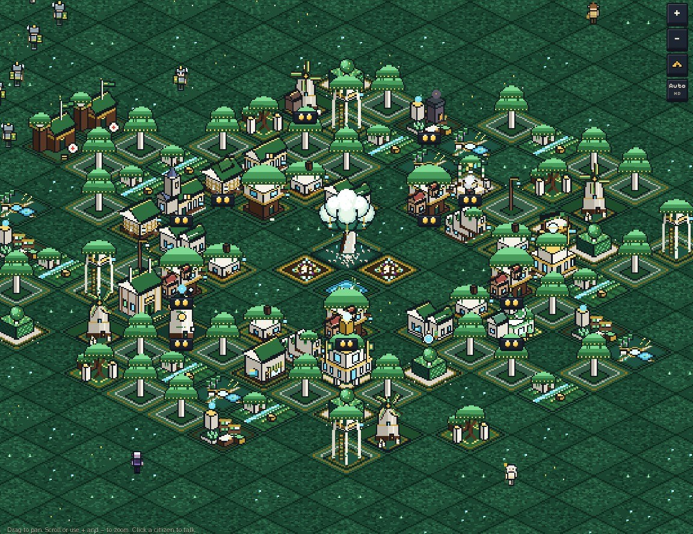
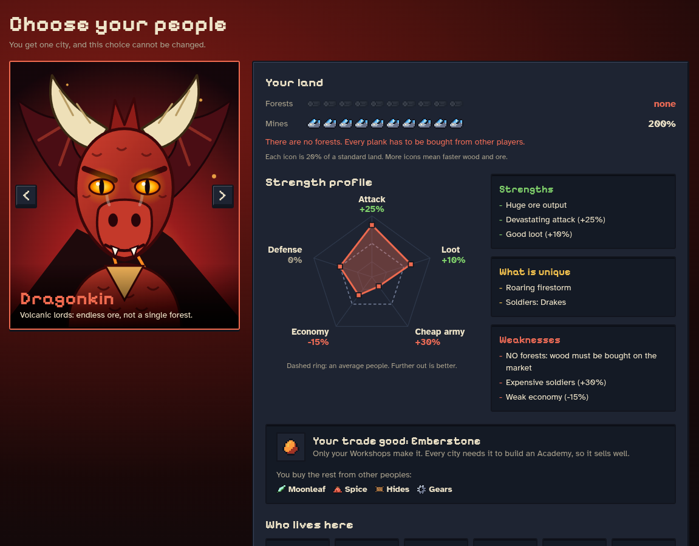
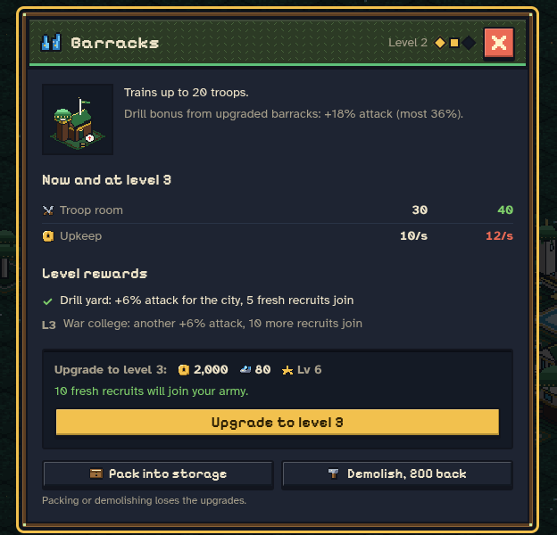
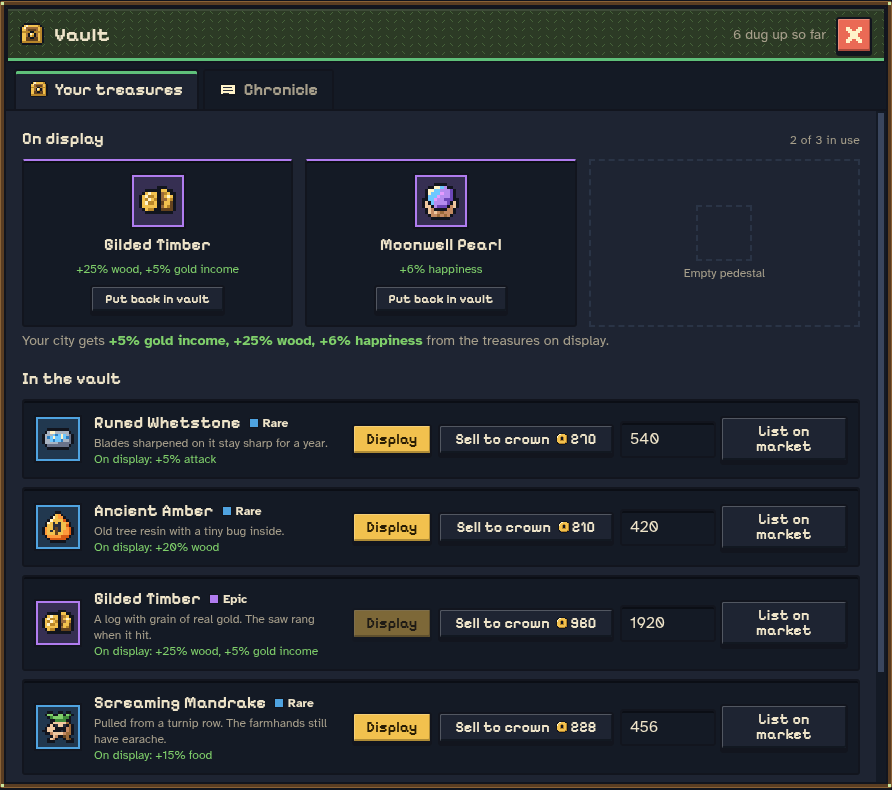
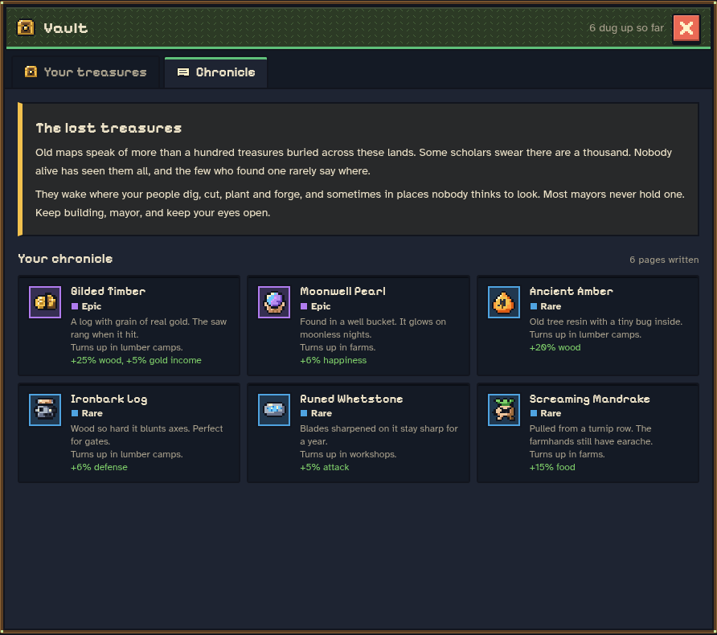
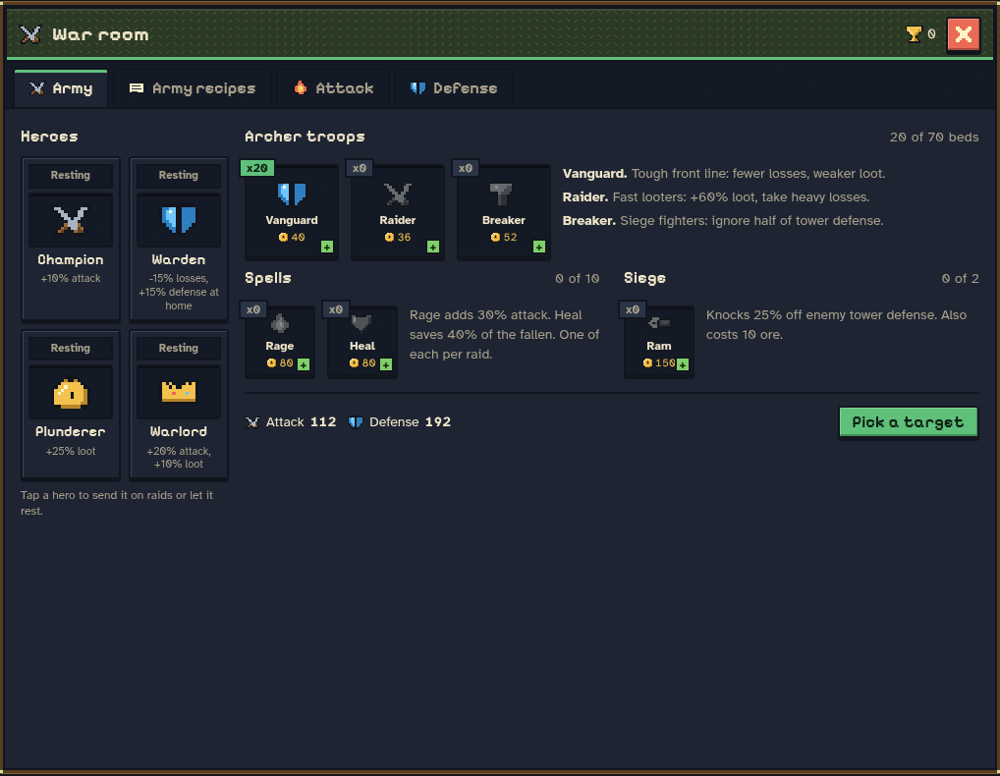
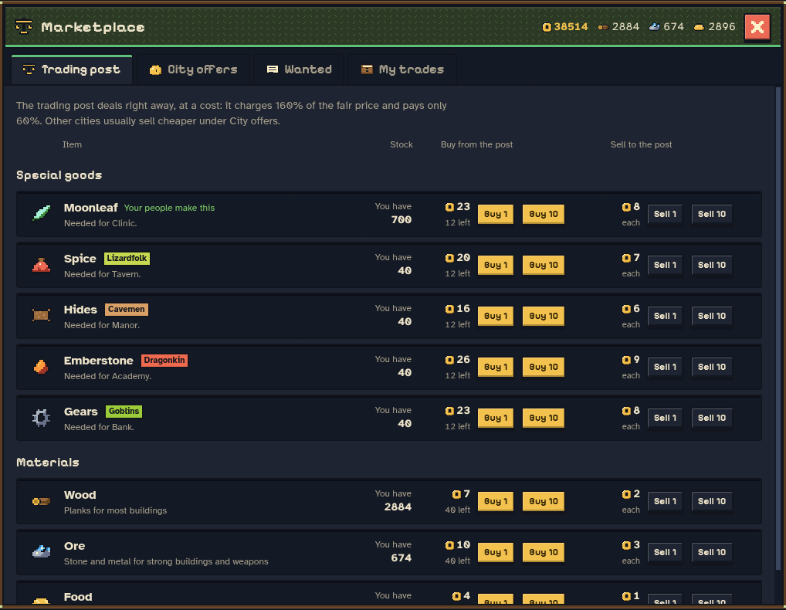
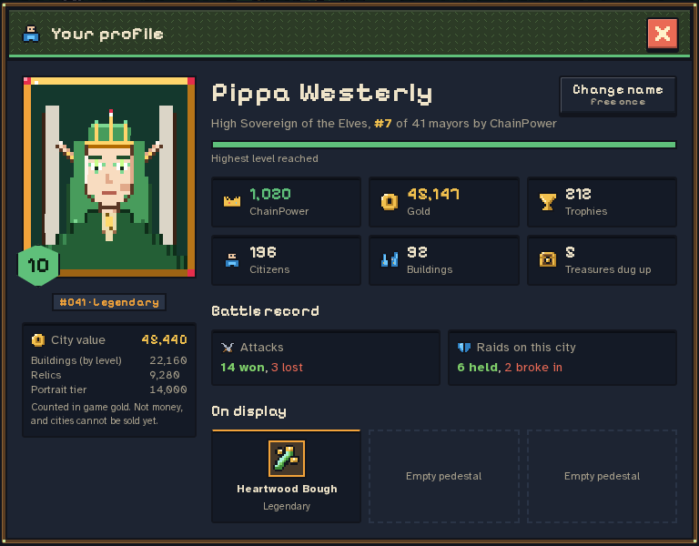
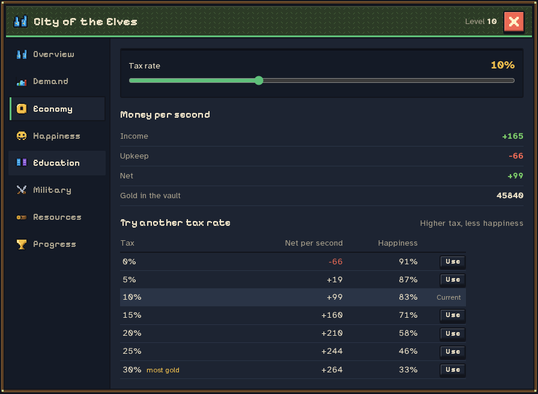

# Metropolix

**Ten minutes is all it takes to feel what it is like to rule a fantasy realm.**

We built Metropolix because we wanted to play it. Somewhere past midnight on a
long week of work, we started sketching a little kingdom: elves in tree houses,
lizardfolk trading spice across a swamp, dragonkin digging ore out of a volcano,
and goblins who would steal the boots off your guards if you let them. We kept
adding things because they made us grin. A lumber camp that once in a long
while splits a log of real gold. A mayor's profile you can show off to your
rivals. A barracks that, upgraded, marches fresh recruits out onto the streets.

Then we put the city on a blockchain, so it belongs to you.

**Headed for NEAR testnet.** Right now the whole game plays in your browser,
with no sign-up and no download. The contract that will hold your city, its
ChainPower and every battle you win is written and tested in
[`contracts/metropolix/`](contracts/metropolix/). We move the game onto testnet
once it is mature enough, and this README will link the live contract then.

**Play for your coffee.** That is where we are going: once Metropolix is on
chain, playing should earn you coffee money for free, with nothing to put in
but your time. It won't take long.

**In ten minutes** you will have chosen your people, raised your first houses,
watched your citizens find jobs, upgraded a building and probably sent an army
at someone. Try it once, and see whether you want to come back to your city
tomorrow.

| Do this | You'll see |
|---|---|
| **1.** Run `pnpm install && pnpm dev`, open http://localhost:3000 and press **Play now** (or go straight to http://localhost:3000/play) | The landing page shows a city building itself from the real simulation. **Play now** opens **Choose your people**: five portraits with their land, strength profile and trade good. |
| **2.** Pick a people, press **Choose the …**, then **Yes, found my city** | A name prompt with four suggested fantasy names. Roll the dice for more, or type your own. |
| **3.** Press **Shop**, pick **House**, then tap empty tiles on the map | Houses go up and citizens walk in. The people count in the top bar climbs. |
| **4.** Build a **Farm** and a **Market Stall** | Jobs fill, and gold per second in the top bar turns positive. |
| **5.** Hover the happiness chip in the top bar | A breakdown of what raises and lowers happiness, with live numbers. |
| **6.** Once your card shows level 2, tap a house and press **Upgrade to level 2** | The panel shows now versus next; the house on the map takes a new shape. If you are not there yet, the button tells you what is missing. |
| **7.** At level 3, build a **Barracks**, press **Open war room**, train a few troops, then **Pick a target** | A battle result in the log, and your record on your profile. |
| **8.** Press **City**, then **Economy** | Income, upkeep, and a table of every tax rate with its effect on happiness. |
| **9.** Click your card at the top left | Your mayor profile. **Change name** is free once; after that it costs gold. |

| What | Where |
|---|---|
| **The world**: deterministic, integer-only city simulation, 80 tests | [`packages/sim/`](packages/sim/) |
| **The game**: Next.js 16, React 19 and PixiJS 8 pixel isometric client | [`apps/web/`](apps/web/) |
| **The chain**: Rust NEAR contract for cities, snapshots and battles, 22 tests | [`contracts/metropolix/`](contracts/metropolix/) |

---

## Three things we wanted from a city game

**1. A city that answers back.** Every number on screen is something you can
open and read. Hover the happiness meter and it tells you which parks, taxes
and empty stomachs moved it. Open the City panel and it shows you, for every
tax rate from 0% to 30%, what you would earn per second and how happy your
people would be. A good city game should explain itself, and this one tries.

**2. Peoples who need each other.** Each of the five peoples makes one trade
good nobody else can make. Elves grow moonleaf, lizardfolk cure spice, cavemen
tan hides, dragonkin mine emberstone and goblins build gears. Your clinic needs
moonleaf. Your bank needs gears. So you trade, or you raid, and either way
you end up dealing with your neighbours.

**3. Treasure you cannot look up.** Mines, lumber camps, farms, workshops,
barracks and taverns can turn up a treasure while they work: a log with grain
of real gold, the skull of an ancient goblin king, a pearl that glows on moonless
nights. The game never tells you how many exist. Your chronicle only records
what you have dug up yourself, and the old maps say there are more than a
hundred. Some scholars swear there are a thousand.

---

## Choose your people



You get one city, and the choice is permanent. Every people plays differently
because the land under them differs, and the numbers below are what the
simulation actually uses.

| People | Land | Plays like | Trade good |
|---|---|---|---|
| **Elves** | 160% forests, 40% ore | Strong defense (+20%), better economy (+10%), weaker attack | Moonleaf |
| **Lizardfolk** | 110% forests, 70% ore | Cheap soldiers (-10%), good loot (+10%), balanced | Spice |
| **Cavemen** | 130% forests, 60% ore | Very cheap soldiers (-30%), strong attack, poor economy | Hides |
| **Dragonkin** | **no forests at all**, 200% ore | Devastating attack (+25%), expensive soldiers, buy every plank | Emberstone |
| **Goblins** | 60% forests, 150% ore | Best loot (+30%), cheap soldiers, fragile walls | Gears |

The dragonkin are our favourite argument for a market: a people with no trees
has to buy wood from somebody, every single time.

## Building up, not just out



Tap any building and it opens. You see what it does now, what the next level
adds, and what that costs. Most buildings go up to level 3, and each level
changes how the city plays rather than only adding a percentage:

- An upgraded **barracks** drills the whole city (+6% attack per level, up to
  36%) and marches out fresh recruits: 5 at level 2, 10 more at level 3.
- An upgraded **farm** grows new kinds of food. Grain first, then fruit, then
  cheese, and every new kind on the table makes your citizens happier.
- **Houses** hold more families, **shops** earn more, **towers** hold the wall
  harder. Upkeep rises with each level, so growth always costs you something.

You pick your city's name the first time you play, or roll one of 5,472
fantasy names. The first rename is free; after that it costs 1,000 gold, so
choose a name you like.

## The vault and the chronicle



Treasures come in four rarities, and each one does something. Put up to three
on display and your city gets their bonus: Gilded Timber gives +25% wood and +5%
gold income, a Runed Whetstone sharpens every blade for +5% attack. Or sell one
to the crown for gold right away. Or list it on the market and see what another
mayor will pay for it.



The chronicle is a book that only fills as you dig. It never shows the blank
pages ahead.

## The war room



Train three kinds of troops (a steady vanguard, raiders who loot hard and
die fast, breakers who ignore half a tower's defense), brew rage and heal
spells, build rams, and send a hero along. Then pick a target. Rival cities
raid you back on their own schedule, and when you lose, a shield goes up so
you have time to rebuild.

## The market



The trading post deals right away at a stiff price: it charges 160% of the fair
price and pays you 60%. Other cities sell cheaper, post buy orders you can fill
from your storehouse, and fill your own orders if your price is fair. A
lowball order never fills.

## Your profile



Every mayor has a card: title, people, level, rank by ChainPower, battle record
and the treasures on their pedestals. Click any rival in the Social drawer and
you see theirs.

## A city panel that explains itself



Overview, demand, economy, happiness, education, military, resources and
progress, each one a page. The tax table above is what convinced us this was
worth building: you can see the trade-off before you make it.

---

## On-chain

The simulation runs in your browser. The contract keeps what has to be shared
and trusted: who owns which city, the snapshot you committed, ChainPower, and
the result of every battle. It is not deployed yet; until then the NEAR panel
in the game says so and the city plays offline.

| Method | Who | What |
|---|---|---|
| `mint_city()` | any account, once | creates an empty 40×40 city |
| `commit_snapshot(grid, troops, tick, econ_score)` | owner | stores your city after checking the grid, a rising tick, the troop cap and an upper bound on the economy score |
| `attack(target)` | owner | resolves against the target's committed defense, 60 s cooldown per target, random factor 0.85 to 1.15 from `env::random_seed()` |
| `claim_loot()` | owner | pays out and zeroes your claimable loot |
| `get_city`, `get_leaderboard`, `get_constants` | anyone | ChainPower, attack and defense are computed on read |

Events follow NEP-297 (`metropolix` 1.0.0): `city_minted`,
`snapshot_committed`, `battle_resolved`. The wallet layer uses
`@hot-labs/near-connect`, and its 87 KB (gzip) of NEAR code loads only when the
browser is idle or when you press Connect, so the city is playable before any of
it arrives.

## How it is built

**The world is deterministic.** `packages/sim` uses integers only (permille
instead of floats) and a seeded mulberry32 generator, so the same seed and the
same moves give the same city on every machine. That is what will let the
contract replay a city later instead of trusting it.

**It is tested like it matters.** 80 tests in the simulation, property tests
with fast-check among them (economy invariants, raids, trade, the vault, the
name pool, upgrades), and 22 unit and property tests in the contract, plus a
`near-workspaces` sandbox test.

**It runs on modest machines.** On a production build: first paint in about
500 ms, 56 FPS with a p95 frame of 19 ms, and no long tasks while you play. The
renderer has an HD and a Lite mode and drops to Lite on its own when frames run
slow. Every icon is pixel art compiled once to SVG paths, which took the page
from 12,756 DOM nodes to about 1,300.

## Read the rest honestly

- The contract bounds what a client may claim (valid grid, troop cap, a ceiling
  on the economy score) but does not yet replay the simulation. Replay is the
  next step, and the integer-only simulation exists to make it possible.
- The contract knows the first 14 building codes. The client has 23 buildings,
  so the second wave (row houses, manors, taverns, banks and the rest) needs a
  contract update before those cities can commit.
- Rival mayors in the Social drawer are simulated until the game server goes
  live; their profiles say so.
- `get_leaderboard` walks every city. That is fine for a hackathon and not for
  a million players.
- Desktop only for now.

## Reproducing any of it

```bash
pnpm install
pnpm dev                 # http://localhost:3000 (landing), /play (the game)
pnpm test                # 80 simulation tests
pnpm typecheck
pnpm build && pnpm --filter @metropolix/web exec next start

cd contracts/metropolix
cargo test                                              # 22 unit and property tests
cargo build --target wasm32-unknown-unknown --release
cargo test --test workspaces -- --ignored               # sandbox end-to-end, needs network once
```

Screenshots in [`docs/screenshots/`](docs/screenshots/) come from a production
build of this repo and are temporary until the final art pass.
