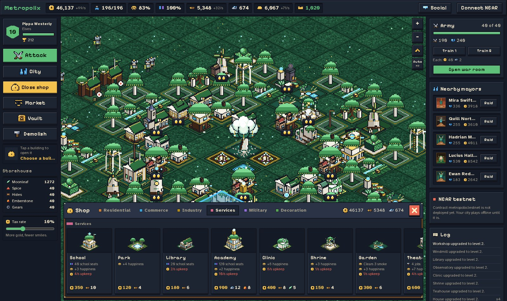
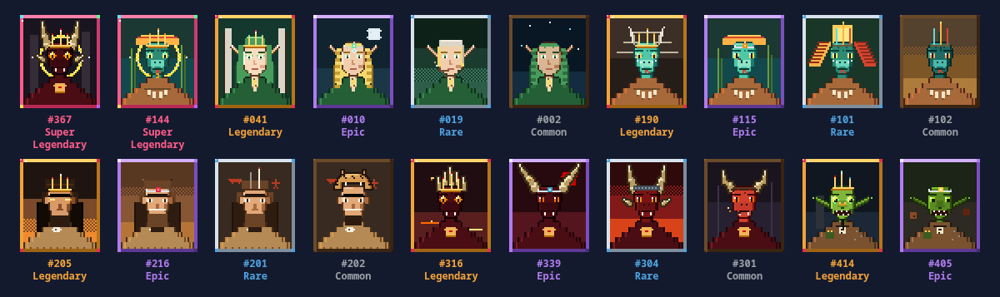

<h1 align="center">Metropolix</h1>

<p align="center"><b>A pixel fantasy city builder you can learn in ten minutes and keep coming back to.</b></p>

<p align="center">
  
  
  
  
  
</p>


Pick one of five peoples, raise a city tile by tile, balance taxes against
happiness, dig up rare treasures and raid rival mayors. It all runs in the
browser with no sign-up. The NEAR contract that will hold your city and your
battles is written and tested, and moves to testnet once the game is ready.

> **What you get in one sitting**
> - **5 peoples** on different land: the dragonkin have no forests and buy every plank.
> - **60 buildings**, each drawn for your people, each up to level 3.
> - **500 mayor portraits** in six tiers. Yours is drawn once. Only two are Super Legendary.
> - **40 rival mayors** with real treasuries to scout and raid. They raid you back.
> - **A city that explains itself**: every number on screen opens into what moved it.

---

## Play it

```bash
pnpm install
pnpm dev        # http://localhost:3000 is the landing page, /play is the game
```

| Do this | You'll see |
|---|---|
| **1.** Press **Play now** and choose a people | Five portraits with their land, strengths and trade good. Then name your city. |
| **2.** **Shop → House**, tap empty tiles, then add a **Farm** and a **Market Stall** | Citizens walk in, jobs fill, gold per second turns positive. |
| **3.** Hover the happiness chip, then open **City → Economy** | What raises and lowers happiness, and every tax rate with its cost before you pick it. |
| **4.** Tap a building and press **Upgrade** | Now versus next, and the building changes shape on the map. |
| **5.** Build a **Barracks**, **Open war room**, pick a target | The expected loot before you attack, the result in the log, your record on your profile. |
| **6.** Click your card at the top left | Your portrait and its tier, your rank and your city's value. |

---

## Why it is fun

<table>
<tr>
<td width="50%"><br><b>Peoples who need each other.</b> Each makes one trade good the others need. Your clinic wants moonleaf, your bank wants gears.</td>
<td width="50%"><br><b>Sixty buildings.</b> Houses bring citizens, jobs bring gold. A level 3 farm grows cheese; an upgraded barracks marches out recruits.</td>
</tr>
<tr>
<td><br><b>Raid with your eyes open.</b> Scout the target's defense and treasury, aim for gold or trophies, bring rage, heal or a ram. Lose, and a shield buys you time.</td>
<td><br><b>Treasure you cannot look up.</b> Mines and mills dig up relics, rarely: one or two an hour in a big city. Display three for a bonus, sell to the crown, or list on the market.</td>
</tr>
<tr>
<td><br><b>A profile worth showing.</b> Portrait and tier, rank by ChainPower, battle record, treasures on display and a city value counted in game gold.</td>
<td><br><b>No hidden math.</b> The tax table shows what every rate earns and what it costs in happiness, before you choose.</td>
</tr>
</table>



**500 portraits, six tiers** (250 Common down to 2 Super Legendary), all drawn
in code from layered traits. Yours is picked once, when you found your city,
and never re-rolled.

| People | Land | Plays like | Trade good |
|---|---|---|---|
| **Elves** | 160% forests, 40% ore | Strong defense, better economy | Moonleaf |
| **Lizardfolk** | 110% forests, 70% ore | Cheap soldiers, good loot, balanced | Spice |
| **Cavemen** | 130% forests, 60% ore | Very cheap soldiers, poor economy | Hides |
| **Dragonkin** | no forests, 200% ore | Devastating attack, buy every plank | Emberstone |
| **Goblins** | 60% forests, 150% ore | Best loot, fragile walls | Gears |

---

## On chain

The game runs in your browser; the contract keeps what has to be shared and
trusted. It is written and tested but **not deployed yet**, and the NEAR panel
in the game says so.

| Method | What it does |
|---|---|
| `mint_city()` | one empty 40×40 city per account |
| `commit_snapshot(grid, troops, tick, econ_score)` | stores your city after checking the grid, a rising tick, the troop cap and a ceiling on the economy score |
| `attack(target)` | resolves against the target's committed defense, 60 s cooldown per target, luck from `env::random_seed()` |
| `claim_loot()`, `get_city`, `get_leaderboard` | pay out loot; read ChainPower, attack and defense |

Events follow NEP-297 (`city_minted`, `snapshot_committed`, `battle_resolved`).
The wallet layer is `@hot-labs/near-connect`, loaded only when the browser is
idle or you press Connect, so the city is playable first.

## How it is built

| Part | What | Where |
|---|---|---|
| **The world** | Integer-only, seeded, deterministic simulation: the same seed and moves give the same city on every machine, so the contract can replay it later. 110 tests, property tests with fast-check among them. | [`packages/sim/`](packages/sim/) |
| **The game** | Next.js 16, React 19, PixiJS 8 isometric renderer with HD and Lite modes. Every sprite, tile, icon and portrait is pixel art drawn in code; no third-party art. | [`apps/web/`](apps/web/) |
| **The chain** | Rust NEAR contract (near-sdk 5), 22 unit and property tests plus a `near-workspaces` sandbox test. | [`contracts/metropolix/`](contracts/metropolix/) |

On a production build the city paints in about half a second and holds around
56 FPS with no long tasks while you play.

**Libraries:** Next.js, React, PixiJS, three.js, GSAP, Lenis, Tailwind CSS,
near-api-js, @hot-labs/near-connect, Vitest, fast-check, near-sdk,
near-workspaces, proptest.

**Built with AI, said plainly.** Claude Code planned the work, wrote most of
the simulation, contract, game UI and landing page, and reviewed every change.
Worker agents (Gemini and Claude Sonnet through the Antigravity CLI) drew most
of the sprites and the portrait generator from written task files; their output
was reviewed and fixed by hand. The owner set the idea, the peoples and the
look, played every build and decided what shipped. Everything here was written
for the hackathon, starting 10 November 2026, with no starter template.

## Limits, stated plainly

- Not on testnet yet. Nothing in the game is money; city value is game gold only.
- Rival mayors are simulated until a game server exists, and their profiles say so.
- The contract bounds what a client may claim but does not replay the simulation yet.
- The contract knows the first 14 building codes; the other 46 need a contract update.
- `get_leaderboard` walks every city: fine for a hackathon, not for a million players.
- Desktop only for now.

## Commands

```bash
pnpm test        # 110 simulation tests
pnpm typecheck
pnpm build && pnpm --filter @metropolix/web exec next start

cd contracts/metropolix
cargo test                                          # 22 unit and property tests
cargo build --target wasm32-unknown-unknown --release
cargo test --test workspaces -- --ignored           # sandbox end-to-end, needs network once
```

## License

[MIT](LICENSE).

> Build a city, find something rare, and see whether you want to come back tomorrow.
