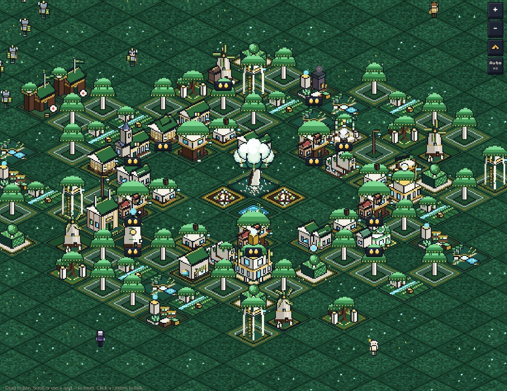
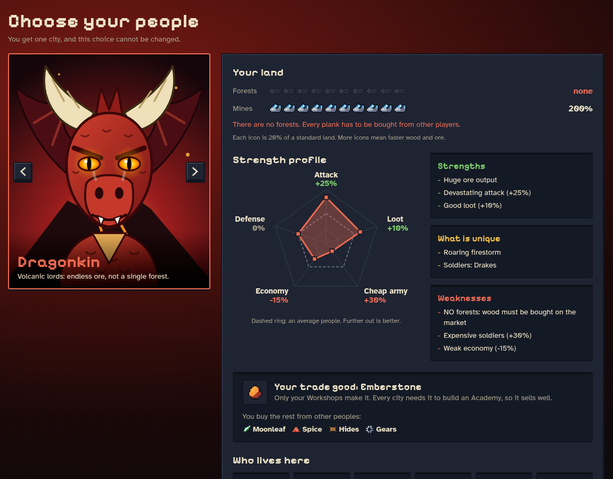
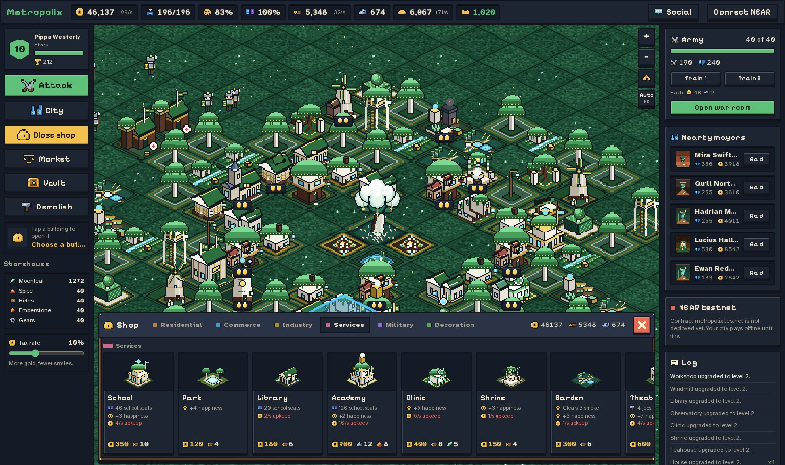
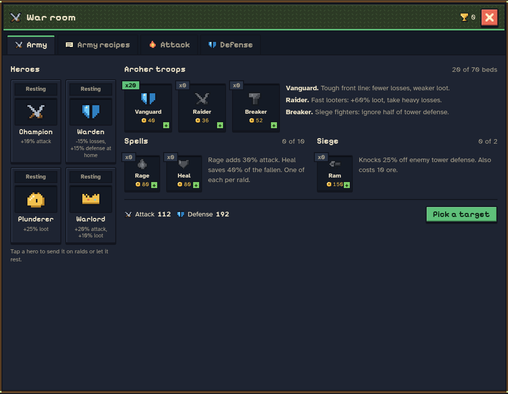
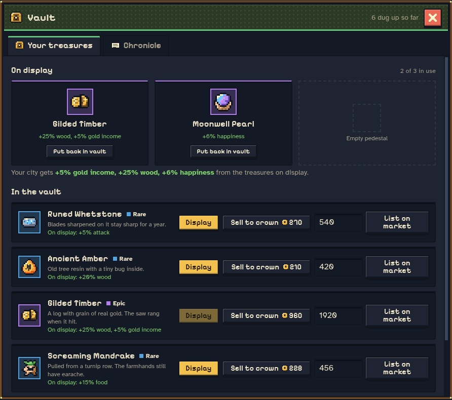
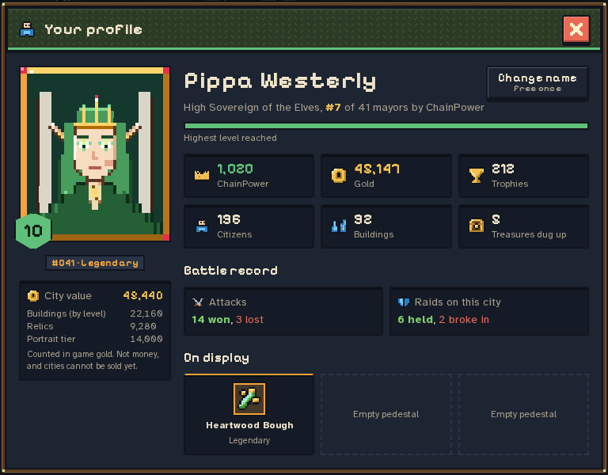
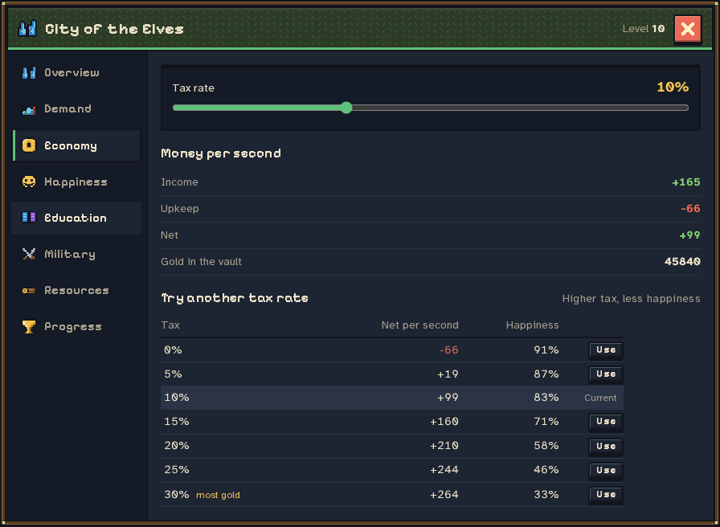
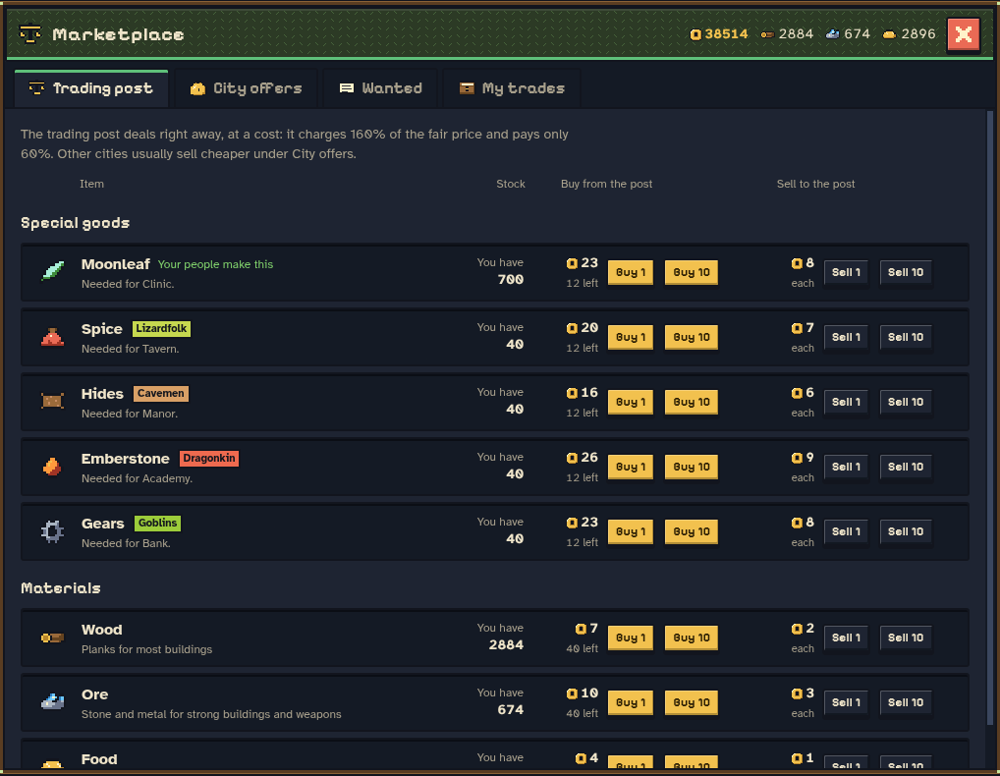
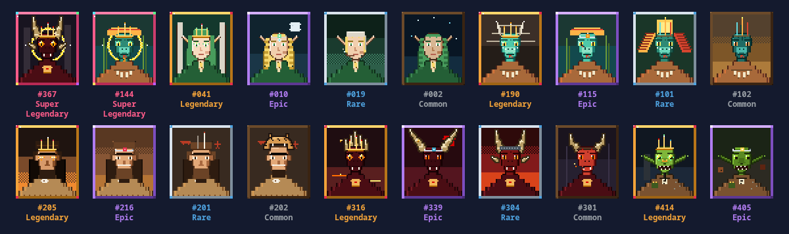

<p align="center"></p>

<h1 align="center">Metropolix</h1>

<p align="center">
  <b>A pixel fantasy city builder where your city lives on NEAR.</b><br/>
  Raise a city in ten minutes, then save it to a Rust contract, raid other players' real treasuries, and trade a coin whose value is the gold in every city.
</p>

<p align="center">
  <a href="https://metropolix-city.vercel.app/play"></a>
  <a href="https://metropolix-city.vercel.app/verify"></a>
  <a href="https://github.com/theodhorex/metropolix"></a>
  <a href="https://nearhackathon.com"></a>
  <br/>
  
  
  
  
  <br/>
  
  
  
  
  <a href="LICENSE"></a>
</p>

---

Metropolix is for **anyone who likes a city builder but is tired of a city that only exists on the developer's server**: the player who wants a rival that is a real person, and the one who wants to trade the economy instead of just watching it.

> **The browser plays the game. The chain keeps what has to be shared and trusted.**
>
> - One Rust contract on NEAR testnet, [`metropolix.testnet`](https://testnet.nearblocks.io/address/metropolix.testnet), holds every player's saved city, runs raids between them, issues the **$METRO** coin and mints treasure **NFTs**.
> - Every save is bounded by the contract: layout and troops are validated, and the clock, gold and XP are clamped to what the city could have earned.
> - A raid is a real battle: the contract runs it with on-chain randomness and moves gold out of the other player's saved treasury.
> - **Don't take our word for it.** [`/verify`](https://metropolix-city.vercel.app/verify) reads raw views from a NEAR RPC node and recomputes every city's ChainPower and the coin's NAV in your browser. Today: 3 cities, 1 coin, 0 mismatches.



## For judges: try it in 5 minutes

Every step is "do X, see Y". Steps 1 to 6 need no wallet and no account.

| # | Do | See |
|---|---|---|
| 1 | Open **[metropolix-city.vercel.app/play](https://metropolix-city.vercel.app/play)**, press **Play now**, choose a people, take office | Five portraits with their land, strengths and trade good; then a name prompt and an empty valley |
| 2 | **Shop → House**, tap an empty tile; add a **Farm** and a **Market Stall** | Citizens walk in, jobs fill, gold per second turns positive |
| 3 | Hover the happiness chip, then open **City → Economy** | What raises and lowers happiness, and every tax rate with its cost before you pick it |
| 4 | Tap a building and press **Upgrade** | Now versus next, and the building changes shape on the map |
| 5 | Open the **Vault**, then **Market** | Treasures dug up by mines and mills; NPC orders that never allow an instant arbitrage |
| 6 | Open **[/verify](https://metropolix-city.vercel.app/verify)** | The page reads the contract live and shows each saved city's ChainPower and the $METRO NAV twice, from the chain and recomputed in your browser: **all rows green** |
| 7 | With a NEAR testnet wallet: **Connect NEAR wallet → Found my city on chain** (0.05 testnet NEAR) | One wallet confirmation; your city now exists in the contract and you get 100 $METRO |
| 8 | **Turn on autosave** | One more confirmation adds a function-call key limited to four game methods; from then on the city saves every 5 minutes with no popup |
| 9 | **Players on chain → Raid** a saved city | A battle run by the contract: loot moved on chain, a 5 minute shield for the loser, the result in your log |
| 10 | **$METRO market** | Buy or sell against testnet NEAR; the price sits next to the coin's NAV, and raids move the NAV |
| 11 | Clone and run `pnpm test` (Node 22+) | 178 simulation tests pass, including the one that checks the contract's rule tables against the game |
| 12 | `cd contracts/metropolix && cargo test` | 34 contract tests pass |

The claims-to-evidence matrix for every number in this README is in **[JUDGES.md](JUDGES.md)**. A longer walkthrough is in [docs/TRY_IT.md](docs/TRY_IT.md).

---

### Verify from a terminal (no wallet, no API key)

Three reads straight from NEAR testnet. Expected output: step 1 prints the code hash of the deployed contract, step 2 the coin's supply, reserves, treasury, NAV and mNAV, step 3 the top cities by ChainPower.

```bash
RPC=https://test.rpc.fastnear.com
# 1. The code hash of the deployed contract (DAmujFPaq...U2U at the time of writing)
curl -s $RPC -H 'content-type: application/json' -d '{"jsonrpc":"2.0","id":1,"method":"query","params":{"request_type":"view_account","finality":"final","account_id":"metropolix.testnet"}}' | grep -o '"code_hash":"[^"]*"'
# 2. The $METRO coin: supply, pool reserves, treasury, city index, NAV and mNAV (permille)
curl -s $RPC -H 'content-type: application/json' -d '{"jsonrpc":"2.0","id":1,"method":"query","params":{"request_type":"call_function","finality":"final","account_id":"metropolix.testnet","method_name":"get_coin","args_base64":"e30="}}' | python3 -c "import sys,json;print(bytes(json.load(sys.stdin)['result']['result']).decode())"
# 3. The top three cities by ChainPower, as the contract computes it ({"limit":3})
curl -s $RPC -H 'content-type: application/json' -d '{"jsonrpc":"2.0","id":1,"method":"query","params":{"request_type":"call_function","finality":"final","account_id":"metropolix.testnet","method_name":"get_leaderboard","args_base64":"eyJsaW1pdCI6M30="}}' | python3 -c "import sys,json;print(bytes(json.load(sys.stdin)['result']['result']).decode())"
```

To rebuild the contract and compare its hash: `cd contracts/metropolix && cargo build --target wasm32-unknown-unknown --release`, then take the SHA-256 of `target/wasm32-unknown-unknown/release/metropolix_contract.wasm` and compare it, in base58, with step 1 (it matched on the author's machine on 15 Nov 2026).

---

## What Makes Metropolix Special

### Who This Is For

Meet Dewi. Dewi plays a browser city builder every night. The "raid" button attacks a bot, the leaderboard is whatever the server says, and the in-game coin is a number in a database. When the studio shuts the server down, the city is gone, and nobody could ever check that the rankings were honest.

Dewi does not need a bigger city. Dewi needs a city that **belongs to Dewi's wallet**, rivals that are real, and an economy where every number can be checked.

---

### The Problem

- **Your city lives on someone else's server**: close the tab, lose the server, lose the city.
- **Raids on bots prove nothing**: there is no real rival and no real stake.
- **In-game currencies are database rows**: nobody can see what backs them or why they move.
- **Rankings cannot be audited**: you trust the studio that they are fair.
- **Putting a whole game on chain is too slow and too costly**: a city that ticks every second cannot pay gas every second.

**How might we keep the fast, free feel of a browser game while moving everything that has to be shared and trusted onto a chain anyone can check?**

---

### The Solution

Metropolix splits the game along one line. Four pieces.

**1. The browser plays; the chain bounds.** The city simulation (60 buildings, citizens, taxes, happiness, 40 rival mayors) is an integer-only, seeded, deterministic engine that runs in the page. Every save the player sends is **validated and clamped by the contract** (layout, troops, clock, gold, XP), so a client cannot claim a city or a fortune it could not have earned.

**2. Real raids between real players.** `attack` runs the battle inside the contract on the saved cities, with luck from `env::random_seed()`. A win moves up to 35% of the target's on-chain gold, shields them for five minutes, and a raid with no star takes nothing.

**3. A coin backed by the cities.** **$METRO** (NEP-141) trades against testnet NEAR in an x·y=k pool. Its NAV is the treasury plus the gold saved in every city, so raids move it. Above 2x mNAV the contract issues new METRO into the pool; below 0.9x the treasury buys METRO back and burns it. There is no oracle: every input is contract state.

**4. Treasures as NFTs.** Relics dug up in the vault mint as NEP-171 NFTs (rate-limited and gated by saved level), can be transferred to another player, and burn when returned to the game.

---

### Measured, not promised

| Claim | A typical browser game | Metropolix | Evidence |
|---|---|---|---|
| Who holds your city | The studio's server | A contract state keyed by your NEAR account; read it from any RPC node | `get_city`, [`/verify`](https://metropolix-city.vercel.app/verify) |
| A raid between players | A bot, or a server-side roll you cannot see | Run by the contract with on-chain randomness; 3 real battles recorded (two 3 star wins that took 7,000 and 2,177 gold, and a raid with no star that took nothing) | `get_battles`, [`/api/chain/battles`](https://metropolix-city.vercel.app/api/chain/battles) |
| What backs the coin | A database row | Treasury plus the gold of every saved city; mNAV 1.18x on 15 Nov 2026, 4 swaps recorded | `get_coin`, `/verify` section 3 |
| ChainPower ranking | "Trust us" | Computed by the contract and recomputed in your browser: **3 of 3 cities match, to the digit** | `/verify`, `packages/sim/tests/verify.test.ts` |
| Client cheating | Whatever the client sends | Layout validated, troops and XP bounded, gold and clock clamped to what could have been earned | `commit_snapshot`, 34 contract tests |
| Contract review | Unknown | Two AI audit rounds, every finding fixed with a test; deployed code hash equals a fresh build | [Limits](#limits-stated-plainly), the terminal check above |

---

## Features

<table>
<tr>
<td width="50%"><br><b>Peoples who need each other.</b> Five peoples on different land, each making one trade good the others need. Your clinic wants moonleaf, your bank wants gears.</td>
<td width="50%"><br><b>Sixty buildings.</b> Houses bring citizens, jobs bring gold. A level 3 farm grows cheese; an upgraded barracks marches out recruits.</td>
</tr>
<tr>
<td><br><b>Raid with your eyes open.</b> Scout the target's defense and treasury, aim for gold or trophies, bring rage, heal or a ram. Lose, and a shield buys you time.</td>
<td><br><b>Treasure you can mint.</b> Mines and mills dig up relics, rarely: one or two an hour in a big city. Display three for a bonus, sell to the crown, list on the market, or mint one as an NFT.</td>
</tr>
<tr>
<td><br><b>A profile worth showing.</b> Portrait and tier, rank by ChainPower, battle record, treasures on display and a city value counted in game gold.</td>
<td><br><b>No hidden math.</b> Every number on screen opens into what moved it, and the tax table shows what each rate earns and costs in happiness before you choose.</td>
</tr>
<tr>
<td><br><b>A market that cannot be farmed.</b> NPC orders always sit below NPC offers of the same item, so there is no instant arbitrage.</td>
<td><br><b>500 portraits, six tiers.</b> 250 Common down to 2 Super Legendary, drawn in code from layered traits. Yours is picked once, when you found your city, and never re-rolled.</td>
</tr>
</table>

- **60 buildings**, each drawn for your people, each up to level 3.
- **40 rival mayors** with real treasuries to scout and raid. They raid you back.
- **Cities saved on NEAR**: founding costs 0.05 testnet NEAR for storage and gives a 100 $METRO welcome grant; one city per account.
- **Autosave with no popups**: a function-call access key limited to four methods, no deposits, 0.25 NEAR of gas allowance.
- **Restore on any device**: *Load my city from chain* rebuilds your city from the contract.
- **Players on chain**: a live list of saved cities with ChainPower, defense and treasury, one click from a raid.
- **$METRO market**: buy and sell against NEAR, with the NAV, mNAV, pool reserves and recent swaps on screen.
- **Relic NFTs**: mint, transfer and return treasures, with the three-an-hour mint limit shown.
- **Verify page**: [`/verify`](https://metropolix-city.vercel.app/verify) audits the chain in your browser.
- **Four languages** on the landing page (English, Bahasa Indonesia, Korean, Chinese).

| People | Land | Plays like | Trade good |
|---|---|---|---|
| **Elves** | 160% forests, 40% ore | Strong defense, better economy | Moonleaf |
| **Lizardfolk** | 110% forests, 70% ore | Cheap soldiers, good loot, balanced | Spice |
| **Cavemen** | 130% forests, 60% ore | Very cheap soldiers, poor economy | Hides |
| **Dragonkin** | no forests, 200% ore | Devastating attack, buy every plank | Emberstone |
| **Goblins** | 60% forests, 150% ore | Best loot, fragile walls | Gears |

---

## Why the Chain Can Be Trusted With the Rules

### Rules enforced by the contract

| Rule | What the contract does |
|---|---|
| One city per account | `mint_city` attaches 0.05 NEAR for storage and refuses a second city |
| A legal layout | `commit_snapshot` panics on an unknown building code, a wonder built by the wrong people, a limit exceeded or a bad grid size |
| Troops and XP | The army must fit the barracks of the saved layout; XP never falls and grows at most 10 a second |
| Clock, gold, XP | Clamped to real time since the mint plus one hour of play from before the wallet, and to what the layout could have earned after paying for its new buildings; the result says what was kept |
| Raids | 60 second cooldown, new cities under level 3 protected, a 5 minute shield after a loss, a win takes up to 35% of the target's on-chain gold |
| Trophies | A defense is worth only the trophies the attacker lost (up to 3), so a trophy-less alt cannot farm them |
| The coin | Each trade applies issue or buyback in proportion to its size (full at 1% of the pool); a buyback never spends more than the trade's own fee |
| Relics | 3 mints an hour; epic, legendary and mythic need saved level 3, 5 and 7; returning a relic burns the token |

### Invariants the tests hold

- The contract's building and people tables are **generated from the simulation**, and a test fails if they drift.
- `city_index` always equals the sum of `isqrt(gold)` over every saved city, after saves and after raids.
- ChainPower, level and NAV recomputed outside the contract equal the contract's answers (`verify.test.ts`).
- No client claim can raise gold above the bound; an over-large first save is capped, not rejected.

---

## NEAR Integration

What NEAR makes possible here, concretely:

| NEAR feature | How Metropolix uses it |
|---|---|
| **Smart contract (Rust, near-sdk 5)** | One contract keeps cities, battles, the coin and the relics; 34 unit tests |
| **Function-call access keys** | Autosave adds one key limited to `commit_snapshot`, `attack`, `mint_relic` and `return_relic`, no deposits, 0.25 NEAR of gas. Anything that moves NEAR still goes through the wallet |
| **On-chain randomness** | `env::random_seed()` decides the luck in every raid |
| **NEP-141 fungible token** | $METRO, with a built-in x·y=k pool against NEAR and a treasury |
| **NEP-171 non-fungible token** | Relic NFTs minted from the vault, transferable with `nft_transfer`, burned on return |
| **NEP-297 events** | Mint, burn, issue and buyback emit standard events that the indexer and explorers read |
| **Storage staking** | Founding a city attaches 0.05 NEAR that stays with the contract and pays for the city's storage; `storage_unregister` is disabled, so a deposit cannot be farmed back out |
| **Public RPC** | The game and `/verify` read straight from FastNEAR's testnet RPC; the indexer is only a cache |
| **Wallet selector** | `@hot-labs/near-connect` loads only when the browser is idle or you press Connect, so the city is playable first |

### Accounts (NEAR testnet)

| Account | Role |
|---|---|
| [`metropolix.testnet`](https://testnet.nearblocks.io/address/metropolix.testnet) | The contract: cities, raids, $METRO, relic NFTs |
| `metropolix-p1.testnet`, `metropolix-p2.testnet` | Two test players that founded cities and fought the first recorded battles |
| `metropolix-p3.testnet` | A third test player, founded from scratch in an end-to-end run: found, save, raid, swap, mint, transfer and return a relic NFT |

The contract's methods:

| Method | What it does |
|---|---|
| `mint_city(arc, name, portrait)` | one city per account; attach 0.05 NEAR for its storage, get a 100 $METRO welcome grant |
| `commit_snapshot(grid, levels, army, gold, xp, tick)` | saves the city after checking the layout (60 building kinds), the troop cap and XP never falling; clamps the clock, gold and XP and returns what was kept |
| `attack(target, commit, focus)` | a War Room battle against another player's saved city, luck from `env::random_seed()` |
| `buy_metro`, `sell_metro`, `quote_*`, `get_coin` | $METRO (NEP-141) against testnet NEAR in an x·y=k pool, 1% fee to the treasury, NAV rules after every swap |
| `mint_relic(kind)`, `return_relic(token_id)`, `nft_transfer` | a treasure as a NEP-171 NFT; returning it burns the token |
| `get_city`, `get_cities`, `get_leaderboard`, `get_battles`, `get_rules` | read cities, ChainPower, the last 200 battles and the contract's rule tables |

**$METRO and its NAV.** NAV = (treasury + city index × k) / supply, where the city index is the sum of `√gold` over every saved city. mNAV is the pool price over NAV. When mNAV reaches 2x the contract issues 0.5% more METRO into the pool; under 0.9x the treasury buys METRO back and burns it. Raids move gold between cities, so they move NAV, and players can trade the gap. The `√` keeps one huge city from being the whole coin.

**Reads go through an indexer.** `/api/chain/*` pulls the contract's views at most every 5 minutes (and on demand after an action) into Postgres when `DATABASE_URL` is set, or into server memory otherwise. A GitHub Actions cron also calls `/api/chain/sync` every 5 minutes. The game reads players, battles, coin history and NFTs from there and your own city straight from the RPC.

---

## Don't Trust It, Recompute It

Open **[`/verify`](https://metropolix-city.vercel.app/verify)**. The page reads raw views (`get_cities`, `get_coin`, the contract's code hash) straight from a NEAR testnet RPC node, with no indexer and no server of ours in the loop, and recomputes in your browser:

- every saved city's level, buildings, economy, attack, defense and **ChainPower** from its stored grid, and
- the **$METRO backing**: city index, NAV, pool price and mNAV.

Chain value and recomputed value are shown side by side; any mismatch turns the row red. The recomputation ([`packages/sim/src/verify.ts`](packages/sim/src/verify.ts)) uses the same rule tables the contract was generated from, and [`verify.test.ts`](packages/sim/tests/verify.test.ts) replays it against saved chain data. It matched the deployed Rust contract digit for digit on 15 Nov 2026. The page also lists, rule by rule, what the chain rejects, clamps or computes and what stays in the browser, so the trust model is on the table rather than in the fine print.

---

## Architecture

### System flow

```
 browser (Next.js 16, React 19, PixiJS 8)                       NEAR testnet
 ┌──────────────────────────────────────┐                  ┌──────────────────────────┐
 │ packages/sim: seeded integer engine  │  commit_snapshot │ metropolix.testnet (Rust)│
 │ city, economy, war, vault, 40 mayors │ ───────────────► │ cities · raids · $METRO  │
 │ apps/web: renderer, panels, wallet   │  attack, swaps   │ relic NFTs · rule tables │
 │ /verify: recompute from raw views    │ ◄─────────────── │ (bounds every save)      │
 └──────────────┬───────────────────────┘   RPC views      └────────────┬─────────────┘
                │ /api/chain/* (cache)                                   │ get_cities, get_coin
                ▼                                                        ▼
        Neon Postgres  ◄──── GitHub Actions cron every 5 min ───── FastNEAR RPC
```

### One raid

1. The attacker's autosave key calls `attack(target, commit, focus)`.
2. The contract loads both saved cities, applies cooldown, shield and level protection, and runs the battle with `env::random_seed()`.
3. A win moves up to 35% of the target's on-chain gold to the attacker, updates both cities' `city_index` terms and trophies, and shields the target for five minutes.
4. The result is stored in the battle log (last 200) and emitted; the NAV of $METRO moves because the gold index moved.
5. The target's next save subtracts the gold it lost, so an old client snapshot cannot undo the raid.

### How it is built

| Part | What | Where |
|---|---|---|
| **The world** | Integer-only, seeded, deterministic simulation: the same seed and moves give the same city on every machine. 178 tests, property tests with fast-check among them. | [`packages/sim/`](packages/sim/) |
| **The game** | Next.js 16, React 19, PixiJS 8 isometric renderer with HD and Lite modes. The landing page has four languages. | [`apps/web/`](apps/web/) |
| **The chain** | Rust NEAR contract (near-sdk 5, near-contract-standards for NEP-141 and NEP-171), 34 unit tests; a test fails when its building tables drift from the simulation. | [`contracts/metropolix/`](contracts/metropolix/) |
| **The indexer** | Next.js route handlers over the contract's views, Neon Postgres or memory. | [`apps/web/app/api/chain/`](apps/web/app/api/chain/) |
| **The audit page** | Browser-side recomputation of ChainPower and NAV from raw RPC data. | [`apps/web/components/Verify.tsx`](apps/web/components/Verify.tsx), [`packages/sim/src/verify.ts`](packages/sim/src/verify.ts) |

On a production build the city paints in about half a second and holds around 56 FPS with no long tasks while you play.

---

## All Tests

| Suite | Runs | What it covers |
|---|---|---|
| `packages/sim/tests/sim.test.ts` | `pnpm test` | Economy, citizens, taxes, happiness, upgrades, war, trade, vault |
| `packages/sim/tests/balance.test.ts` | `pnpm test` | Balance guards (no runaway gold, fair peoples) |
| `packages/sim/tests/world.test.ts` | `pnpm test` | The 40 rival mayors, news, raids on you |
| `packages/sim/tests/names.test.ts`, `portrait.test.ts` | `pnpm test` | Name generator, portrait determinism and tier odds |
| `packages/sim/tests/contract-tables.test.ts` | `pnpm test` | Fails if the contract's generated rule tables differ from the game |
| `packages/sim/tests/verify.test.ts` | `pnpm test` | Recomputed ChainPower and NAV equal the deployed contract's answers (saved chain data) |
| `packages/sim/tests/audit.test.ts` | `pnpm test` | Hostile inputs (NaN, Infinity, fractions), invariant fuzzing, and a check that ordering and relisting cannot print gold |
| `contracts/metropolix` unit tests (34) | `cargo test` | Layout validation, clamps, raids, protection, coin, relics |

Total: **178 simulation tests and 34 contract tests, all passing.**

---

## Tech Stack

| Layer | Tools |
|---|---|
| Game | Next.js 16, React 19, PixiJS 8, three.js, GSAP, Lenis, Tailwind CSS |
| NEAR client | near-api-js, @hot-labs/near-connect |
| Indexer | Next.js route handlers, @neondatabase/serverless (Neon Postgres) |
| Contract | Rust, near-sdk 5, near-contract-standards |
| Tests | Vitest, fast-check, cargo test |
| Art | Canvas pixel art and procedural Blender recipes ([`tools/blender`](tools/blender)) rendered to WebP; no third-party art or models |
| Hosting | Vercel, Neon, GitHub Actions |

**Built with AI, said plainly.** Claude Code planned the work, wrote most of the simulation, contract, game UI and landing page, and reviewed every change. Worker agents (Gemini and Claude Sonnet through the Antigravity CLI) drew most of the sprites and the portrait generator from written task files; their output was reviewed and fixed by hand. The owner set the idea, the peoples and the look, played every build and decided what shipped.

---

## Setup

### Requirements

Node 22+, pnpm, and for the contract Rust with the `wasm32-unknown-unknown` target.

### Run the game

```bash
pnpm install
pnpm dev        # http://localhost:3000 is the landing page, /play is the game, /verify the audit
```

To run it as production does: `pnpm build && pnpm --filter @metropolix/web exec next start`.

### Run the tests

```bash
pnpm test        # 178 simulation tests, including the contract-table sync check and the chain recomputation
pnpm typecheck

cd contracts/metropolix
cargo test       # 34 unit tests
```

### Build the contract

```bash
cd contracts/metropolix
cargo build --target wasm32-unknown-unknown --release   # .cargo/config.toml adds --cfg near so panics keep their message
# tables.rs is generated: cd packages/sim && UPDATE=1 npx vitest run tests/contract-tables.test.ts
```

---

## Repository Layout

```
apps/web/               Next.js game, landing page, /verify, indexer routes (/api/chain)
packages/sim/           deterministic simulation, rule tables, chain recomputation (verify.ts)
contracts/metropolix/   Rust NEAR contract: cities, raids, $METRO, relic NFTs
tools/blender/          procedural Blender recipes that render the building sprites
docs/                   logo and README screenshots
.github/workflows/      the 5-minute indexer sync
```

---

## Limits, Stated Plainly

**Trustless (the chain decides, you can verify):** who owns a saved city, the outcome and loot of every on-chain raid, ChainPower, the leaderboard, the coin's supply, pool and NAV, and who holds each relic NFT.

**Bounded, not replayed:**
- The contract bounds what a client may claim (layout, troops, clock, gold, XP) but **does not replay the simulation**. Gold from trades and AI raids beyond that bound is saved at the bound, and the panel says so. What the contract computes from those bounded facts (ChainPower, raids, NAV) can be audited on [`/verify`](https://metropolix-city.vercel.app/verify).
- Treasure finds are not proven on chain: the vault lives in the browser. Minting is rate-limited and gated by saved level.
- Rival AI mayors are simulated in the browser; only players who founded a city on chain can be raided on chain.
- Heroes, spells and rams are left out of on-chain battles.

**Not proven:**
- The contract went through two AI audit rounds before the deadline (storage refunds, first-save bounds, stacked grace on quick saves, unpaid buildings, buyback size, alt-account shields and trophies, double-counted loot, overflow); every finding is fixed and has a test. There was no external commercial audit and no formal proof.
- Testnet only: $METRO and the NFTs have no real value, and only three test players have fought on chain so far.
- Built for desktop: it runs in a mobile browser and you can tap to build, but the map and side panels are cramped on a phone.
- Desktop only for now.

---

## Hackathon Notes

- **Built for NEAR HACKATHON.** Tracks: **Games**, **Memecoins** and **NFTs**.
- **Timeline (Q-001):** work started on 10 November 2026, inside the window that opened with the announcement on 19 October. There is no pre-hackathon baseline and no starter template; the full history is in `git log`.
- **Libraries and AI tools (Q-005):** Next.js, React, PixiJS, three.js, GSAP, Lenis, Tailwind CSS, near-api-js, @hot-labs/near-connect, @neondatabase/serverless, Vitest, fast-check, near-sdk, near-contract-standards. Code was written with AI assistance, described in [Tech Stack](#tech-stack).
- **Our other submission (Q-015):** the same team also submits a second, unrelated project, [Scrip](https://github.com/theodhorex/scrip): spending mandates on NEAR that let an AI agent pay for things with a budget instead of a wallet, in the AI Security and Agent Economy tracks (live at [scrip-dev.vercel.app/try](https://scrip-dev.vercel.app/try)). It shares no code or contract with Metropolix; its README lists its own tracks.
- **Testnet only (Q-010):** the contract, the coin and the NFTs are on NEAR testnet and have no real value.

---

## License

[MIT](LICENSE)

> Build a city, find something rare, and see whether you want to come back tomorrow.
